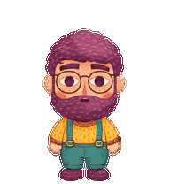

# 胡桃 · Hu Tao

根据头像创作的 ChatGPT Work / Pets 动画伙伴：圆框眼镜、紫色头发与大胡子、暖黄色上衣和青绿色背带裤。



这份项目保存最终宠物图、原始头像、生成的动作条、创作提示词、检查记录，以及本次制作的可复用 Python 工具。

## 动画资源

- `assets/spritesheet.png`：透明 v2 动画图，1536 × 2288，8 列 × 11 行，每格 192 × 208。
- 九组标准动作共 57 帧，加上 16 个顺时针视线方向，共 73 帧；剩余 15 格透明。
- `assets/previews/`：动作 GIF、转头 GIF、静止—跳跃—静止 GIF、关键帧和 MP4。
- `source/rows/`、`references/`、`creation/`：源图、原始头像、创作说明和提示词。
- `qa/`：原始制作流程的检查结果。账号中的宠物 ID 和临时上传链接不属于可移植资源。

## 在本地运行工具

需要 Python 3.10 或更新版本；安装 FFmpeg 后还可输出 MP4。

```sh
python3 -m venv .venv
source .venv/bin/activate
python -m pip install -r requirements.txt
python scripts/verify_assets.py
python scripts/render_previews.py
```

生成的预览放在 `build/previews/`，不会覆盖已检查的动画图。脚本不需要 OpenAI API key，也不依赖本机安装目录。

`verify_assets.py` 检查已保存资源的摘要、动画图格式和格子占用；正式导入仍需由 Pets 的上传前检查确认兼容性。新的图像生成和完整宠物创建流程使用 Pets 插件的 create-pet 技能。

`scripts/register_standard_rows.py` 保存了本次制作使用的行内统一缩放和地面位置调整工具。输入是已提取的帧目录及 `frames-manifest.json`，例如：

```sh
python scripts/register_standard_rows.py extracted-frames build/registered-frames
```

## 从 GitHub 安装

把宠物仓库链接交给装有 Pets 插件的助手，即可下载兼容动画图，检查后导入。私有仓库需要访问该仓库的 GitHub 登录。

对于客户端可直接访问的 HTTPS 动画图，也可以生成官方支持的安装链接：

```sh
python scripts/make_install_link.py --image-url 'https://example.com/spritesheet.png'
```

命令会输出 `codex://pets/install?...&spriteVersionNumber=2`。打开链接后进入桌面客户端的宠物安装流程。请把示例 URL 替换成实际可访问的动画图地址；私有仓库的网页链接通常不能直接作为图片地址。

安装链接格式依据 [OpenAI 官方桌面命令文档](https://learn.chatgpt.com/docs/app/commands#pets)，核实日期为 2026-11-08。

## 保存到 GitHub

登录自己的 GitHub 账号后，在这个目录运行：

```sh
gh auth login --hostname github.com --git-protocol https --web
gh repo create hutao-pet --private --source . --remote origin --push
```

如果已经设置了远程仓库，使用 `git push -u origin main`。本项目默认按私有备份整理，未附加开源许可。

## 制作记录

最终动画图通过了原制作流程的透明边缘、网格、动作与十六方向检查，以及 Pets 服务的上传前检查。部分斜向视线的变化比较轻微，保留了盲测分歧和后续人工复核记录，详见 `qa/`。

动画图 SHA-256：

```text
2444042e3fd1d23cc47b72589592bf90eaa76d0829bd1e70da39839734cef64b
```
